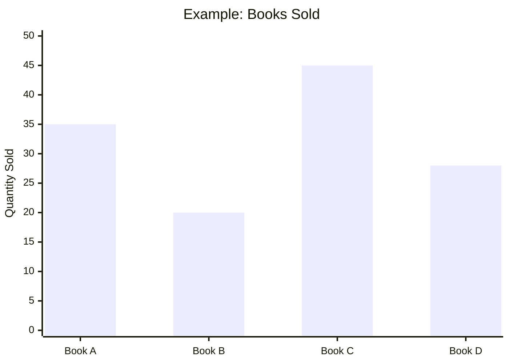
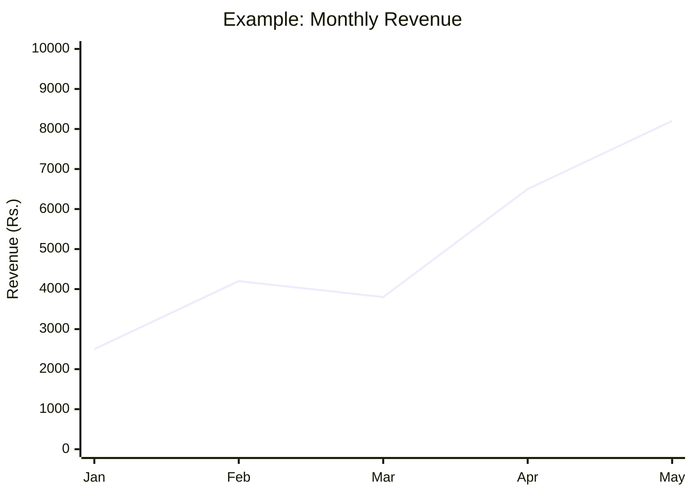

# 📚 Bookstore Management System

<p align="center">

  

</p>

<p align="center">
  
  
  
  
  
</p>

<p align="center">

  **A simple, interactive, and data-driven bookstore management application built using Python.**

  Manage inventory, record book sales, calculate revenue, generate reports, and visualize business performance through charts.

</p>

---

## ✨ Project Overview

The **Bookstore Management System** is a menu-driven Python application designed to simplify everyday bookstore operations.

It helps store owners manage books, maintain stock quantities, record sales transactions, and analyze sales performance using graphical visualizations.

The project uses **Pandas** for data handling, **NumPy** for calculations, **Matplotlib** for plotting, and **Seaborn** for chart styling.

### 🎯 Project Goals

- 📖 Maintain an organized book inventory.
- ➕ Add new books and remove existing books.
- 📦 Update stock quantities.
- 🛒 Record sales and automatically calculate revenue.
- 💾 Store inventory and sales data in CSV files.
- 📊 Generate sales summaries and business reports.
- 📈 Visualize sales and revenue using graphs.

---

## 🚀 Key Features

| Feature | Description |
|---|---|
| 📚 Inventory Management | View all available books and their details. |
| ➕ Add Books | Add a book with its title, author, genre, price, and quantity. |
| 🗑️ Remove Books | Remove a book from the inventory. |
| 📦 Stock Updates | Update the available quantity of a book. |
| 🛍️ Sales Management | Record sales and reduce stock automatically. |
| 💰 Revenue Calculation | Calculate revenue from each recorded sale. |
| 📋 Sales Reports | Display books sold, total revenue, average sale revenue, and best-selling books. |
| 📊 Data Visualization | Generate four types of charts to analyze bookstore performance. |
| 💾 CSV Storage | Save inventory and sales records between program runs. |
| 🛡️ Input Validation | Handle invalid prices, quantities, missing books, and insufficient stock. |

---

## 🧩 How the System Works

The following workflow shows how the main components interact.

```mermaid
flowchart TD
    A(["📚 Start Application"]) --> B["📂 Load inventory.csv and sales.csv"]
    B --> C{"🖥️ Select Menu Option"}
    C --> D["📖 View Inventory"]
    C --> E["➕ Add or Remove Books"]
    C --> F["📦 Update Stock"]
    C --> G["🛒 Record a Sale"]
    G --> H{"Stock Available?"}
    H -- Yes --> I["💰 Calculate Revenue"]
    I --> J["📉 Reduce Stock"]
    J --> K["💾 Save CSV Files"]
    H -- No --> L["⚠️ Show Error Message"]
    E --> K
    F --> K
    C --> M["📊 Generate Sales Report"]
    C --> N["📈 Display Charts"]
    D --> C
    K --> C
    L --> C
    M --> C
    N --> C
    C --> O(["🚪 Exit"])
    
    classDef start fill:#12372A,color:#fff,stroke:#67D5A0
    classDef process fill:#17365D,color:#fff,stroke:#60A5FA
    classDef decision fill:#684B13,color:#fff,stroke:#FACC15
    classDef end fill:#4C1D45,color:#fff,stroke:#E879F9
    
    class A start
    class B,D,E,F,G,I,J,K,L,M,N process
    class C,H decision
    class O end
```

> 💡 **Note:** The workflow diagram is interactive only to the extent supported by the Mermaid viewer; it is not an animated GIF. The animated typing banner above provides the animation effect.

---

## 📊 Data Visualization Gallery

The application generates four different charts using its sales and inventory data.

### 1. 📊 Books Sold — Bar Chart

**Purpose:** Compare the number of copies sold for each book.

- Identifies popular books.
- Helps compare sales performance.
- Makes best-selling titles easier to spot.



<sub>Illustrative example only. Actual values depend on your sales.csv file.</sub>

### 2. 📈 Monthly Revenue — Line Chart

**Purpose:** Show how total sales revenue changes over time.

- Groups sales by month.
- Helps identify revenue trends.
- Supports simple monthly performance comparisons.



<sub>Illustrative example only. Actual values depend on your recorded sales.</sub>

### 3. 🍰 Revenue by Genre — Pie Chart

**Purpose:** Compare the revenue contributed by different book genres.

- Shows each genre's share of total revenue.
- Helps understand which categories perform well.
- Makes genre-level revenue comparisons easier.

<sub>Run option 7 in the application to generate the actual pie chart.</sub>

### 4. 🔥 Sales Correlation — Heatmap

**Purpose:** Visualize the correlation between the quantity sold and total revenue.

- Uses a correlation matrix.
- Displays the relationship between numerical sales columns.
- Helps explore patterns in recorded transactions.

<sub>Run option 7 in the application to generate the actual heatmap.</sub>

---

## 🛠️ Technology Stack

| Technology | Usage |
|---|---|
| 🐍 Python | Main programming language |
| 🐼 Pandas | Reading, updating, grouping, and saving data |
| 🔢 NumPy | Numerical calculations |
| 📉 Matplotlib | Creating bar, line, and pie charts |
| 🎨 Seaborn | Heatmap styling and visual presentation |
| 📄 CSV | Persistent storage for inventory and sales |

---

## 📁 Project Structure

Organize your project files like this:

```text
Bookstore-Management-System/
│
├── bookstore.py       # Main Python application
├── inventory.csv      # Book inventory records
├── sales.csv          # Sales transaction records
├── README.md          # Project documentation
│
└── screenshots/       # Optional screenshots for GitHub
    ├── inventory.png
    ├── sales-report.png
    └── charts.png
```

**Important:** Your Python code loads `inventory.csv` and `sales.csv` when the application starts. Both files must exist in the working directory before you run the program.

### 📄 Sample CSV Files

**inventory.csv**

```csv
Title,Author,Genre,Price,Quantity
Python Basics,John Smith,Education,450,20
The Lost World,Arthur Doyle,Fiction,300,15
Data Science 101,Jane Doe,Technology,550,12
```

**sales.csv**

```csv
Date,Title,Quantity Sold,Total Revenue
2026-10-01,Python Basics,2,900
2026-10-02,The Lost World,3,900
2026-10-03,Data Science 101,1,550
```

> ⚠️ These are sample records for testing. You can replace them with your own data. Keep the column names exactly as shown because the program depends on them.

---

## ⚙️ Installation and Setup

Follow these steps to run the application on your computer.

### Step 1: Install Python

Download and install Python from the official website:

[🐍 Download Python](https://www.python.org/downloads/)

During installation on Windows, enable **Add Python to PATH** if that option is available.

### Step 2: Open the Project in VS Code

1. Open Visual Studio Code.
2. Select **File → Open Folder**.
3. Select your `Bookstore-Management-System` folder.
4. Open the integrated terminal using **Terminal → New Terminal**.

### Step 3: Install Required Libraries

Run the following command in the VS Code terminal:

```bash
python -m pip install pandas numpy matplotlib seaborn
```

### Step 4: Prepare the CSV Files

Create `inventory.csv` and `sales.csv` in the same folder as `bookstore.py`.

Copy the sample CSV content above into the respective files.

### Step 5: Run the Application

```bash
python bookstore.py
```

If your Python command is configured differently on Windows, try:

```bash
py bookstore.py
```

---

## 🖥️ Application Menu

When you start the program, the following menu appears:

```text
BOOKSTORE SYSTEM

1. Show inventory
2. Add book
3. Remove book
4. Update stock
5. Record sale
6. Sales report
7. Show graphs
8. Exit

Choose 1-8:
```

### 🎮 Menu Guide

| Option | Action |
|---|---|
| `1` | Display all books |
| `2` | Add a new book |
| `3` | Remove a book |
| `4` | Update book stock |
| `5` | Record a book sale |
| `6` | Display the sales report |
| `7` | Generate visualization charts |
| `8` | Save the data and exit |

---

## 🧮 Example: How Revenue Is Calculated

Suppose a customer purchases 3 copies of a book priced at ₹450 each.

\[
\text{Revenue} = \text{Price} \times \text{Quantity Sold}
\]

\[
\text{Revenue} = 450 \times 3 = ₹1350
\]

The application then:

1. Calculates the revenue.
2. Reduces the book's stock by 3.
3. Adds a transaction to `sales.csv`.
4. Saves the updated data.

This keeps inventory and sales records synchronized during normal program operation.

---

## 📋 Reports and Business Insights

The sales report provides useful information, including:

- 📦 Total quantity of books sold.
- 💰 Total revenue generated.
- 🧾 Average revenue per recorded transaction.
- 🏆 Best-selling books ranked by quantity sold.
- 📚 Current inventory levels.

These reports help demonstrate how basic data analysis can support everyday bookstore decisions.

---

## 🧪 Testing Checklist

Before presenting or submitting the project, test the following scenarios.

- [ ] View the inventory successfully.
- [ ] Add a new book with valid information.
- [ ] Try adding an existing book.
- [ ] Remove an existing book.
- [ ] Try removing a book that does not exist.
- [ ] Update stock with a valid quantity.
- [ ] Attempt to update stock with a negative quantity.
- [ ] Record a sale with sufficient stock.
- [ ] Attempt a sale with insufficient stock.
- [ ] Generate the sales report.
- [ ] Generate all four charts.
- [ ] Restart the application and verify that saved data remains available.

---

## 🔮 Future Enhancements

The following features could make the project even more advanced:

- 🔐 Login system for administrators.
- 🖥️ Graphical user interface using Tkinter.
- 🔍 Search and filter books by title, author, or genre.
- 📅 Date-based sales reports.
- 📤 Export reports to Excel or PDF.
- ⚠️ Low-stock notifications.
- 💳 Customer and payment management.
- 🌐 Web-based bookstore dashboard.
- 🗃️ Database integration using SQLite.

---

## 🎓 Learning Outcomes

This project demonstrates practical use of:

- Object-oriented programming with Python classes.
- Conditional statements, loops, and functions.
- CSV file handling and persistent data storage.
- Pandas DataFrames and data aggregation.
- Numerical analysis with NumPy.
- Data visualization with Matplotlib and Seaborn.
- Basic input validation and transaction management.

It is a useful beginner-to-intermediate project for learning Python programming and data analysis.

---

## 👨‍💻 Author

**Project:** Bookstore Management System

**Language:** Python

**Category:** Inventory Management & Sales Data Analysis

**Status:** Working command-line project with CSV storage and graphical reporting.

---

## ⭐ Support

If you find this project useful, consider giving the repository a ⭐ on GitHub.

**Manage books. Track sales. Understand your data. Build smarter.** 📚📊

